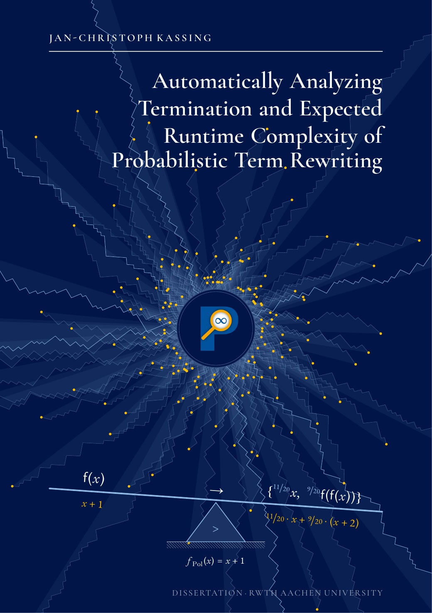

**Author**: J.-C. Kassing

**Reviewers**: Prof. Jürgen Giesl and Prof. Ugo Dal Lago

**Date of the oral examination**: October 1, 2026

Probabilistic programs (i.e., programs that can make random choices during execution) are central to modern computing. They are used for randomized algorithms, Bayesian inference, cryptographic protocols, and many other applications. While randomness brings many benefits, it also introduces new challenges for formal verification. In particular, a probabilistic program may terminate with probability one (almost-sure termination, AST) while still admitting infinite executions. Moreover, even when termination is guaranteed with probability one, the expected runtime may be infinite, motivating the stronger notion of strong almost-sure termination (SAST) where for every initial state, the expected runtime is bounded by a finite constant, uniformly for all resolutions of the non-determinism.

In this thesis, we present a framework for the automatic analysis of AST and SAST for probabilistic term rewrite systems (PTRSs), a rule-based functional programming language that combines non-determinism with probabilistic choice. Since programs in languages such as Java, C, Haskell, and Prolog can be automatically transformed into term rewrite systems, approaches based on term rewriting have broad applications. We present several contributions towards this goal. Most notable is the annotated dependency pair framework, a modular, divide-and-conquer method for proving AST and SAST. We extend this framework to derive upper bounds on the expected runtime and complement it with automated techniques for disproving AST and SAST via reductions to stochastic processes such as random walks. Moreover, we investigate several other important properties for termination analysis. First, we consider relations between different evaluation strategies: when does AST for an innermost (or call-by-value) evaluation strategy imply AST for an arbitrary evaluation strategy? This is an important question for automatic termination analysis as it is easier to prove termination for innermost evaluation than for an arbitrary evaluation strategy. Second, we show how the combination of two disjoint systems behaves if both original systems are AST or SAST. Finally, we present restrictions on PTRSs under which AST becomes decidable, yielding the first decision procedure for AST of a non-trivial subclass of PTRSs. 

All techniques to analyze PTRSs have been implemented in the tool AProVE and demonstrate strong performance in the annual termination competition.
